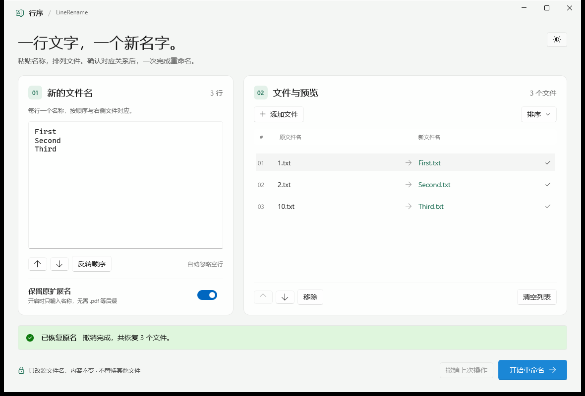
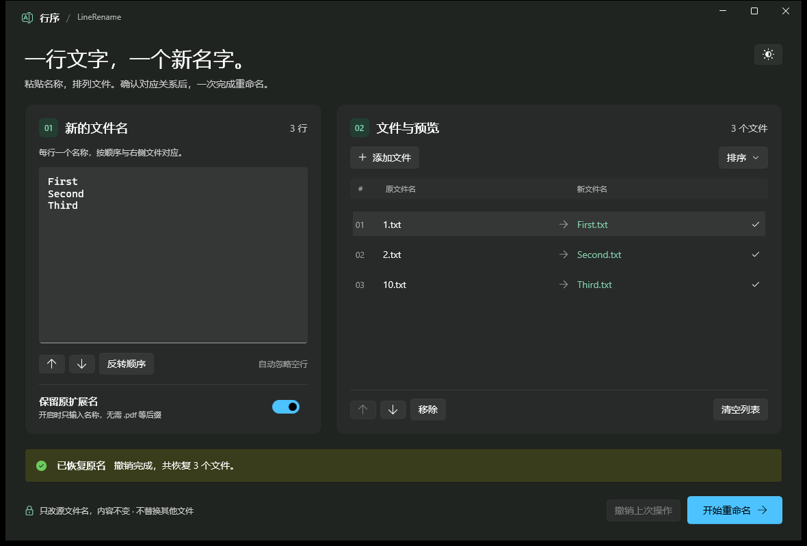

# 行序 · LineRename

**一行文字，一个新名字。** 粘贴几行文字，拖入几个文件，按行对应批量重命名。

基于 WinUI 3（Windows App SDK）的 Windows 桌面小工具：左边粘贴名称，每行一个；右边排列文件，实时预览对应关系，确认后一次完成重命名。只改文件名，内容与所在文件夹不变，不生成副本。




## 下载

**[Release 页面下载](https://github.com/cut-hand/LineRename/releases/latest)**，提供两种分发形式，均含 `SHA256SUMS.txt` 校验文件：

| 文件 | 体积 | 运行要求 |
|---|---|---|
| `LineRename.exe` | 约 90MB | 无需任何环境，双击即用（推荐） |
| `LineRename-FrameworkDependent.zip` | 约 10MB | 目标机器需已安装 .NET 10 桌面运行时与 Windows App SDK 运行时 |

> 自包含单文件约 90MB 属于正常现象：其中真正的应用代码不足 1MB，其余是打包进 EXE 的 .NET 10 运行时与 WinUI 3 框架，换来的是"拷给任何电脑都能运行"。框架依赖版去掉了这部分（也剔除了与本工具无关的 Windows AI 运行库），体积约为前者的九分之一，适合确定目标环境已装好运行时的场合。
>
> 校验：`certutil -hashfile LineRename.exe SHA256`，与 `SHA256SUMS.txt` 比对即可。

## 使用方法

1. **粘贴名称**：左侧文本框每行输入一个新文件名，空行自动忽略；可用「上移 / 下移 / 反转顺序」调整。
2. **添加文件**：拖入文件或点「添加文件」（快捷键 `Ctrl+O`），新文件自动按文件名自然升序排列（`1, 2, 10` 而非 `1, 10, 2`），可拖动或按钮手动调整。
3. **核对预览**：右侧面板逐行显示「原文件名 → 新文件名」和校验状态，行数不符或名称非法时会标红并阻止执行。
4. **开始重命名**：确认对话框后执行；成功后可用「撤销上次操作」一键还原。

「保留原扩展名」开关（默认开启）：开启时只需输入名称部分，`.pdf` 等后缀自动保留。

## 安全机制

- **两阶段提交**：先把所有文件改名到临时名，再统一改为最终名。任一阶段失败自动回滚，不会留下改了一半的状态。
- **占用保护**：目标名称若被本批次以外的已有文件占用，直接停止，绝不替换那个文件；批次内的互换（swap）则合法。
- **身份校验**：每个阶段都校验文件身份（卷序列号 + 文件索引），防止文件在操作间隙被替换后误改。
- **撤销记录**：成功后保留撤销凭据，一次点击恢复全部原名；操作前会提示将替换上一条撤销记录。

## 从源码构建

要求：Windows 10 17763 及以上，x64。首次构建会自动把 .NET SDK 10.0.401 安装到项目内 `.tools/` 目录，不改动系统环境。

```powershell
# 运行测试（181 项），然后同时发布两种单文件产物：
#   artifacts\SingleFile\LineRename.exe                  自包含（无需运行时）
#   artifacts\LineRename-FrameworkDependent.zip          框架依赖（体积小，需运行时）
.\Build.ps1

# 只发布其中一种，或发布普通文件夹版本
.\Build.ps1 -Target SingleFile
.\Build.ps1 -Target FrameworkDependent
.\Build.ps1 -Target Folder          # artifacts\LineRename\ 文件夹形式

# 构建后直接启动
.\Start.cmd
```

其他脚本：

- `scripts\Test-Ui.ps1` — 原生 UI 自动化回归（真实窗口 + UIA 驱动，在隔离临时目录中运行）
- `scripts\Inspect-Ui.ps1` — 界面截图捕获
- `scripts\Make-Icon.ps1` — 生成应用图标

## 技术栈与结构

WinUI 3 · Windows App SDK 2.5.1 · .NET 10 · C# · 自包含单文件发布（带压缩）

```
src/
  LineRename.Core/    重命名规划与执行引擎（无 UI 依赖，可独立测试）
  LineRename.App/     WinUI 3 界面
tests/
  LineRename.Tests/   181 项文件系统级测试（规划、校验、执行、回滚、撤销）
scripts/              UI 自动化回归、截图、图标脚本
docs/                 界面截图
Build.ps1             测试 + 发布入口
```
