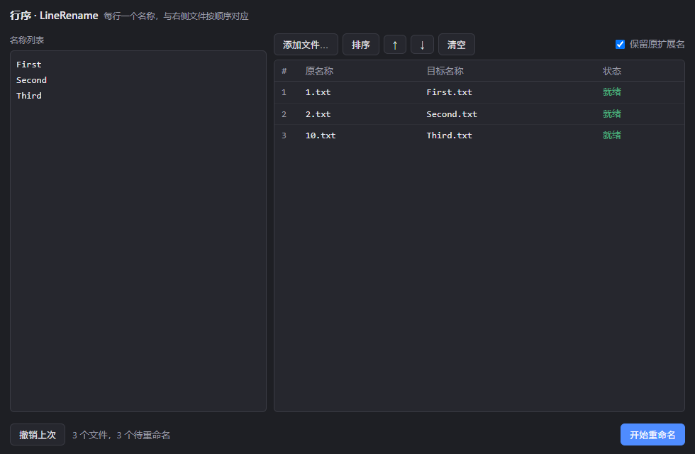

# 行序 · LineRename

**一行文字，一个新名字。** 粘贴几行文字，拖入几个文件，按行对应批量重命名。

Rust + Tauri 2 编写的 Windows 桌面小工具：左边粘贴名称，每行一个；右边排列文件，实时预览对应关系，确认后一次完成重命名。只改文件名，内容与所在文件夹不变，不生成副本。整个应用是一个约 4.7MB 的 EXE，免安装、无框架依赖（Windows 11 自带 WebView2）。



## 下载

**[Release 页面下载](https://github.com/cut-hand/LineRename/releases/latest)**：

| 文件 | 体积 | 运行要求 |
|---|---|---|
| `LineRename.exe` | 约 4.7MB | Windows 11 开箱即用；Windows 10 需安装 [WebView2 运行时](https://developer.microsoft.com/microsoft-edge/webview2/) |

> Release 页面上的 v1.x（WinUI 3 版，约 90MB）为历史版本，v2.0 起改用 Tauri + Rust，体积缩小至约二十分之一。

## 使用方法

1. **粘贴名称**：左侧文本框每行输入一个新文件名，空行自动忽略；可用「上移 / 下移」调整行的顺序。
2. **添加文件**：直接拖入窗口，或点「添加文件…」选择；新文件自动按文件名自然升序排列（`1, 2, 10` 而非 `1, 10, 2`）——手动调整过顺序时，新文件会按自然序追加到列表末尾，不打乱你的排列。「排序」按钮可整体重排并显示变动项数，再次点击切换为倒序（按钮上的箭头提示下一次点击的方向），也可用「上移 / 下移」手动微调。
3. **核对预览**：右侧表格逐行显示「原名称 → 目标名称」与状态；行数不符或名称非法时会明确标出并跳过该项。
4. **开始重命名**：确认对话框后执行；成功后可用「撤销上次」一键还原。

「保留原扩展名」开关（默认开启）：开启时只需输入名称部分，`.pdf` 等后缀自动保留。

## 安全机制

- **两阶段提交**：先把所有文件改名到临时名，再统一改为最终名。任一阶段失败自动回滚，不会留下改了一半的状态。
- **占用保护**：目标名称若被本批次以外的已有文件占用，该项跳过，绝不替换那个文件；批次内的互换（swap）则合法。
- **身份校验**：每个阶段都校验文件身份（卷序列号 + 文件索引），防止文件在操作间隙被替换后误改。
- **撤销记录**：成功后保留撤销凭据，一次点击恢复全部原名；新操作会替换上一条撤销记录。

## 从源码构建

要求：Windows 10 17763 及以上，x64；[Rust 工具链](https://rustup.rs)（MSVC 目标）与 WebView2 运行时。

```powershell
.\Build.ps1        # 构建 release：src-tauri\target\release\LineRename.exe

# 运行单元测试（26 项）
cargo test --manifest-path src-tauri\Cargo.toml

# 界面冒烟测试（真实窗口 + WebView2 CDP 驱动，在隔离临时目录中运行）
powershell -NoProfile -ExecutionPolicy Bypass -File scripts\Test-TauriUi.ps1
```

## 技术栈与结构

Rust · Tauri 2 · 无框架前端（单文件 HTML/CSS/JS，无 npm 依赖）

```
src-tauri/
  src/core.rs       重命名规划引擎（自然排序、占用检测、名称校验）
  src/executor.rs   两阶段执行器（临时名中转、身份校验、回滚、撤销凭据）
  src/main.rs       Tauri 命令层与状态
ui/index.html       单文件界面
scripts/Test-TauriUi.ps1   界面冒烟测试（CDP 驱动）
docs/               截图
Build.ps1           构建入口
```
